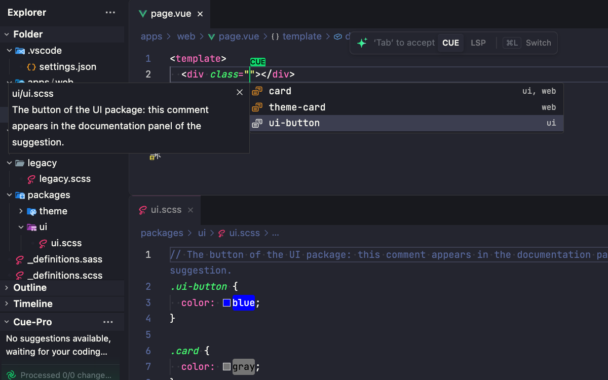

# Sass/SCSS IntelliSense

[](https://github.com/boomba286/sass-scss-completion/actions/workflows/ci.yml)
[](https://code.visualstudio.com/)
[](https://nodejs.org/)
[](https://sass-lang.com/)
[](https://github.com/boomba286/sass-scss-completion/blob/main/LICENSE)

🚀 Autocomplete and diagnostics for the Sass a project defines: parameter names for functions and mixins, the members of the modules you `@use`, and the CSS custom properties of the workspace.

🏷️ The class, id, and attribute names your stylesheets define are suggested inside the `class`, `id`, and other attributes of an HTML, Vue, Svelte, or Astro template.

✨ Parameters you have already passed by name are never suggested twice, and preceding positional arguments are taken into account. Built-in Sass modules (`sass:math`, `sass:color`, …) are supported out of the box, and so are the functions, mixins, and variables you `@use` from your own files.

```scss
@function rem($value, $base: 16) {
  @return math.div($value, $base) * 1rem;
}

.card {
  /* 💡 typing `$` after the positional argument suggests `$base` */
  width: rem(12, $);
}
```

## ✨ Features

### 🧵 Your own functions, mixins, and variables

- ✅ Suggests parameter names when you type `$`, a comma, or just after an opening parenthesis.
- ✅ Works for the `@function` and `@mixin` definitions in your project, called by bare name or through a `@use`d module.
- ✅ After a `@use`d module's `namespace.` completes its functions and mixins, and after `namespace.$` completes its variables, resolved from the file the `@use` points at.
- ✅ Follows `@forward` re-exports, so `namespace.` and `namespace.$` also complete the members a module passes on from the files it forwards.
- ✅ Completes the members a module loads with `@use '...' as *`: a bare `$` suggests its variables and a bare name its functions and mixins, with no namespace.
- ✅ A `$` also completes the variables in scope at the cursor: the file's own declarations in order, `@mixin`/`@function` parameters, and `@each`/`@for` loop variables.
- ✅ Skips named parameters already used in the current call and accounts for preceding positional arguments.
- ✅ Indexes `@function`, `@mixin`, and `$variable` declarations from the SCSS and Sass files in the workspace.

### 🎨 Built-in Sass modules

- ✅ Recognizes namespaces loaded with `@use 'sass:<module>'` (including `as <alias>`).
- ✅ Completes parameters for built-in functions and mixins, marking each as **required**, **optional (with default)**, or **rest**.
- ✅ Completes built-in module members after `namespace.` and built-in variables after `namespace.$` (for example `math.$pi`).
- ✅ Works for all seven built-in modules (`math`, `string`, `color`, `list`, `map`, `selector`, and `meta`).

### 🔗 Namespace and `@use` completion

- ✅ In `@use 'sass:…` completes built-in module ids together with a short description.
- ✅ Completes the names of namespaces already loaded with `@use`.

### 🎛️ CSS custom properties

- ✅ Inside `var(...)` completes the `--name` custom properties declared anywhere in the workspace.
- ✅ Reads declarations from any rule (`:root` included) and accepts a fallback, as in `var(--name, 0)`.

### 🏷️ Class and attribute names in templates

- ✅ Completes the names a workspace stylesheet defines inside the `class`, `id`, and other attributes of an HTML, Vue, Svelte, or Astro template.
- ✅ Reads the names from the selectors themselves — `.name` for `class`, `#name` for `id`, and `[name]` / `[name=value]` for attributes — so BEM (`&__element`) and `#{$name}` interpolation over a literal list (`$name: a, b`, or the items of an `@each`) are covered.
- ✅ Reads the selectors from `.scss`, `.sass`, and plain `.css` files alike, so a stylesheet written in CSS contributes to the templates it is grouped with.
- ✅ Shows the `label` of the group a suggestion comes from next to it (or its source path when the group has no label), and the comment written above the selector in the documentation panel.
- ✅ Restricts suggestions per template with the `groups` setting, which pairs stylesheet globs with the template globs they apply to.



### 💬 Hover documentation

- ✅ Hovering a built-in function or mixin shows its signature, per-parameter descriptions (required/optional/default), a usage example, and a link to the official documentation.
- ✅ Hovering a built-in variable shows its description and documentation link.
- ✅ Hovering a workspace module member shows its signature.

### 🚨 Diagnostics

- ✅ Underlines built-in module calls that are missing required arguments.
- ✅ Underlines workspace module calls (`ns.fn(...)`, `@include ns.mixin(...)`) that omit a parameter without a default value.
- ✅ Underlines uses of undefined `$variables`, following Sass scoping: a loop variable used outside its loop, or a declaration placed after its use, is reported.
- ✅ Underlines references to a member a `@use`d module does not export: `ns.unknown(...)`, `@include ns.unknown(...)`, and `ns.$unknown`.
- ✅ Underlines a call to a function that no module, workspace file, or Sass global defines, for example `casins(1)` in a variable value or a `@return`.
- ✅ Underlines a CSS property value that the property does not accept, for example `text-transform: uppercases`, `display: flexx`, `color: notacolor`, or `text-transform: casinsss()`.
- ✅ Warns about a `var(--name)` use whose `--name` nothing declares. The compiler accepts an unknown name, so this is a warning, not an error.

## ⚙️ Configuration

Both settings live in the `settings.json` of the workspace (or in your user settings).

| Setting                        | Type       | Default | Description                                                                                                                                                                                                                                                       |
| ------------------------------ | ---------- | ------- | ---------------------------------------------------------------------------------------------------------------------------------------------------------------------------------------------------------------------------------------------------------------- |
| `sass-scss-completion.exclude` | `string[]` | `[]`    | Additional glob patterns excluded from workspace indexing, on top of the built-in list (dependency, build output, and cache directories). Each entry must be a single pattern, for example `vendor-legacy` or `**/generated/**`.                                   |
| `sass-scss-completion.groups`  | `object[]` | `[]`    | Pairs the stylesheet globs (`styles`) a template completion draws from with the template globs (`targets`) they apply to. An optional `label` is shown next to each suggestion. A `styles` glob matches SCSS, Sass, and CSS files. With no group, every stylesheet completes in every template the extension supports. |

Example:

```json
{
  "sass-scss-completion.exclude": ["vendor-legacy", "**/generated/**"],
  "sass-scss-completion.groups": [
    {
      "styles": ["packages/theme/**/*.scss"],
      "targets": ["apps/web/**/*.vue"],
      "label": "web"
    },
    {
      "styles": ["packages/ui/**/*.scss"],
      "targets": ["apps/**/*.{vue,html}"],
      "label": "ui"
    }
  ]
}
```

A group applies a stylesheet to a template when the template path matches one of the group's `targets` globs, and a suggestion shows the `label` of the group its stylesheet belongs to — or its source path when that group has no label. An empty `targets` makes the group apply to every template. Once any group is set, a stylesheet that no group's `styles` names (or a template that no group's `targets` matches) receives no suggestions.

The workspace index is rebuilt automatically when files change and whenever these settings change.

## 🌐 Supported Languages

| Language      | Extensions | Completion | Hover | Diagnostics |
| ------------- | ---------- | :--------: | :---: | :---------: |
| SCSS          | `.scss`    |     ✅     |  ✅   |     ✅      |
| Indented Sass | `.sass`    |     ✅     |  ✅   |     ✅      |
| Vue           | `.vue`     |     ✅     |  ✅   |     ➖      |
| HTML          | `.html`    |     ✅     |  ➖   |     ➖      |
| Svelte        | `.svelte`  |     ✅     |  ➖   |     ➖      |
| Astro         | `.astro`   |     ✅     |  ➖   |     ➖      |

In `SCSS`, `Indented Sass`, and `Vue` the completion covers the Sass members. In `HTML`, `Svelte`, and `Astro` it covers the class, id, and attribute names the workspace stylesheets define; in `Vue` it covers both. The stylesheets the template completion reads are `.scss`, `.sass`, and plain `.css` files; a `.css` file supplies its selectors and custom properties only, since it holds no Sass member or diagnostic to check.

## 🧩 Framework Support

The extension works on the `.scss` and `.sass` files in a project, independent of the framework. Any framework that keeps its styles in real Sass files is covered.

| Framework            | How Sass is used                                                                 | Support                                          |
| -------------------- | -------------------------------------------------------------------------------- | ------------------------------------------------ |
| React / Next.js      | `import styles from './Button.module.scss'` (CSS Modules), or global `.scss`      | ✅ completes inside the `.scss` files            |
| Angular              | `styleUrls: ['./button.component.scss']`, or standalone component style files     | ✅ completes inside component `.scss` files      |
| Vue                  | `<style lang="scss">` in an SFC, or standalone `.scss` files                       | ✅ completes inside `.vue` and `.scss` files     |
| Plain HTML / others  | Standalone `.scss` / `.sass` files                                                 | ✅ completes inside `.scss` and `.sass` files    |

❌ Styles that are not backed by a Sass document are **not** covered, because there is no SCSS text to complete in:

- CSS-in-JS template literals (for example `styled-components` or `emotion`).
- Angular inline `styles: ['...']` string literals.

## 📖 Usage

💡 = where to type for suggestions · ❌ = an error is shown · ⚠️ = a warning is shown · ✅ = no error

### 1. 🧵 Parameters of your own functions and mixins

Define a function or mixin anywhere in the workspace, then call it — by bare name after `@use`, or through the module namespace. Typing `$` (or a comma) suggests the parameters that are still unfilled.

```scss
/* _definitions.scss */
@function rem($value, $base: 16) {
  @return $value;
}

@mixin box($width, $height: 10) {
  width: $width;
  height: $height;
}

/* usage.scss */
@use 'definitions';

.usage {
  /* 💡 typing `$` suggests `$base` (the positional `12` fills `$value`) */
  width: rem(12, $);
}

.card {
  /* 💡 typing `$` suggests `$height` (the positional `100px` fills `$width`) */
  @include definitions.box(100px, $);
}
```

A parameter already passed by name is not suggested again.

```scss
.card {
  /* 💡 `$height` is already used, so only `$width` remains */
  @include definitions.box($height: 10px, $);
}
```

### 2. 📦 Members and variables of an imported module

After a `@use`d module's namespace, its functions and mixins are suggested; after `namespace.$`, its variables are suggested.

```scss
/* _tokens.scss */
$spacing: 8px;

@function scale($factor, $base: 16) {
  @return $factor * $base;
}

@mixin flex-center($gap: 0) {
  display: flex;
  gap: $gap;
}

/* usage.scss */
@use 'tokens';

.grid {
  /* 💡 after `tokens.` suggests `scale` and `flex-center` */
  padding: tokens.scale(2, 8px);
}

.grid {
  /* 💡 after `tokens.$` suggests `$spacing` */
  margin: tokens.$spacing;
}
```

A module that re-exports its members with `@forward` is followed, so the namespace sees the members of the forwarded files too.

```scss
/* _forward.scss */
@forward 'tokens';
@forward 'variables';

/* usage.scss */
@use 'forward' as fr;

.grid {
  /* 💡 after `fr.` suggests `scale` and `flex-center`, re-exported from `tokens` */
  padding: fr.scale(2, 8px);
}

.grid {
  /* 💡 after `fr.$` suggests `$spacing` and `$colors`, re-exported from `tokens` and `variables` */
  margin: fr.$spacing;
}
```

With `@use '...' as *`, the module's members are used without a namespace: a bare `$` suggests its variables, and a bare name its functions and mixins.

```scss
@use 'forward' as *;

.grid {
  /* 💡 a bare `$` suggests `$spacing` and `$colors` */
  margin: $spacing;
}

.grid {
  /* 💡 a bare name suggests `scale`, `flex-center`, `rem`, … */
  padding: scale(2, 8px);
}
```

### 3. 🎨 Built-in Sass modules

The built-in modules are treated the same way as your own files: parameters, members, and variables are all completed.

```scss
@use 'sass:color';
@use 'sass:math';

.button {
  /* 💡 typing `$` here suggests the remaining channel parameters */
  color: color.adjust(#036, $lightness: 20%);
}

.grid {
  /* 💡 after `math.` suggests `div`, `ceil`, `floor`, `percentage`, … */
  width: math.div(10px, 2);
}

.circle {
  /* 💡 after `math.$` suggests `$e`, `$pi`, `$max-number`, … */
  circumference: 2 * math.$pi;
}
```

The modules covered are `math`, `string`, `color`, `list`, `map`, `selector`, and `meta`. Hovering a member shows its signature, per-parameter descriptions (required/optional/default), an example, and a link to the official documentation.

### 4. 🔗 Module paths and loaded namespaces

Inside the quotes of `@use`, the built-in module ids are completed together with a short description. Namespaces already loaded with `@use` are completed by prefix.

```scss
/* 💡 typing inside the quotes suggests built-in modules with descriptions */
@use 'sass:ma';

@use 'sass:color';
@use 'tokens' as t;

.alert {
  /* 💡 typing `co` suggests the `color` namespace */
  color: co;
}
```

### 5. 🚨 Diagnostics

Common mistakes are underlined as errors while you type, before anything reaches the compiler.

```scss
@use 'sass:math';
@use 'definitions' as d;

.a {
  /* ❌ Missing required argument(s) $number2 in the call to math.div. */
  width: math.div(12);
}

.b {
  /* ❌ Missing required argument(s) $value in the call to d.rem. */
  width: d.rem();
}

.c {
  /* ❌ Undefined function d.rem2. */
  width: d.rem2(12);
}

.d {
  /* ❌ Undefined variable d.$missing. */
  margin: d.$missing;
}

.e {
  /* ❌ Used undefined variable $undefined. */
  padding: $undefined;
}

.f {
  /* ❌ Unknown value 'uppercases' for property 'text-transform'. */
  text-transform: uppercases;
}
```

A call whose name nothing defines is reported wherever SassScript runs, for example in a `@return`:

```scss
@function spacing($step) {
  /* ❌ Undefined function casins. */
  @return casins($step);
}
```

A parameter counts as required when it has no default value and is not variadic, so omitting a defaulted one is not an error:

```scss
.card {
  /* ✅ `$base` defaults to 16 */
  width: d.rem(12);
}

.badge {
  /* ✅ the required `$value` is passed by name */
  width: d.rem($value: 12);
}
```

The property-value check validates a value against the value definition syntax of the property, taken from the CSS data. Every standard property whose value can be judged is covered, so `display: flexx`, `color: notacolor`, and `width: abc` are all underlined. A value the compiler resolves — a Sass variable, interpolation, or a call of a function something else defines — says nothing about the value that reaches the stylesheet, so it is left alone. A call of a name nothing defines cannot come from Sass either, so the property judges it like any other value:

```scss
.icon {
  /* ❌ not a value `color` accepts */
  color: notacolor;
}

.card {
  /* ✅ a colour function is a valid <color> */
  color: rgb(0 0 0 / 50%);
}

.hero {
  /* ✅ a Sass variable is resolved by the compiler */
  color: $brand;
}

.label {
  /* ✅ a call to a function something else defines is not judged */
  text-transform: casing();
}

.unknown {
  /* ❌ nothing defines `casinsss`, so the call is judged as an ordinary value */
  text-transform: casinsss();
}
```

### 6. 🎛️ CSS custom properties

The `--name` custom properties declared in the workspace are suggested inside a `var()` call, and a use whose name nothing declares is flagged with a warning. The compiler accepts an unknown name, so it is not reported as an error.

```scss
:root {
  --main-color: skyblue;
  --basic-padding: 5px 15px;
}

.card {
  /* 💡 typing `--` inside `var()` suggests `--main-color` and `--basic-padding` */
  color: var(--main-color);
  /* ✅ a fallback is accepted */
  padding: var(--basic-padding, 0);
}

.badge {
  /* ⚠️ Unknown custom property --brand. */
  color: var(--brand);
}
```

### 7. 🧮 Variable scope

Variables are read the way Sass binds them, so a `$` offers what is actually in scope at the cursor and a use that nothing declares is underlined.

```scss
$base: 8px;

@each $step in 1 2 3 {
  .item {
    /* 💡 `$base` and the loop variable `$step` are completed here */
    margin: $base * $step;
  }
}

.outside {
  /* ❌ Used undefined variable $step. — the loop variable is out of scope */
  margin: $step;
}

.after {
  /* ❌ Used undefined variable $later. — a declaration must come before its use */
  width: $later;
}
$later: 1px;
```

A `$name: value` written inside a flow-control block (`@if`, `@else`, `@each`, `@for`, `@while`) assigns to a variable of the same name in the block that holds the rule when there is one, and is local to the rule otherwise. `!global` binds the name at the root. A `@mixin`/`@function` body sees every root declaration whatever the call order, while its parameters and locals stay local.

## 📦 Installation

Package the extension and install it through **Install from VSIX** in the Extensions view:

```sh
npx @vscode/vsce package
```

## 🤝 Contributing

See [CONTRIBUTING.md](CONTRIBUTING.md) for the development setup and the test commands.

## ⚠️ Known Limitations

- Workspace functions and mixins are indexed by name across the workspace; module visibility is not fully resolved.
- If multiple definitions share a name, the first definition found is used.
- Only definitions in `.scss` and `.sass` files are indexed.
- Workspace variables are completed through `namespace.$`, or as a bare `$name` when the module is loaded with `@use '...' as *`.
- Missing-required-argument diagnostics apply to built-in module calls and to `@use`d workspace modules that the extension can resolve; a parameter counts as required when it has no default value and is not variadic.
- The unknown-member check applies to `@use`d modules that the extension can resolve in the workspace, following their `@forward` re-exports; when a re-exported file cannot be resolved, the module is left out of the check rather than reported.
- The CSS property-value check runs on SCSS only, since the parser does not read indented Sass. It covers the standard properties whose value can be judged from the CSS value definition syntax; vendor-prefixed and non-standard properties are not checked, and a value that holds a Sass variable, interpolation, or a function the property does not know is left alone.
- Variable scope is read from the braces of SCSS. Indented Sass has no braces, so its scopes are read as the root scope: a declaration inside a nested rule is taken as global, which can leave a use the compiler rejects unflagged.
- Inside a `@mixin`/`@function` body a root declaration is accepted whatever its position, while the compiler only sees a global declared before the call. A global declared after a call is therefore not flagged; this keeps the common "declare the global after the mixin, before the include" pattern from being reported.
- A keyword argument written on its own line (`$name: value` as an argument) is read as a declaration, so a use of that name later in the same block is not flagged.
- Custom property names are read from `--name: value` declarations across the workspace, treated as one flat set rather than per scope or per file. A name built with interpolation (`--#{$name}`) is neither completed nor required, so `var(--a#{$x})` is left alone.

## 📄 License

MIT. See [LICENSE](https://github.com/boomba286/sass-scss-completion/blob/main/LICENSE).
